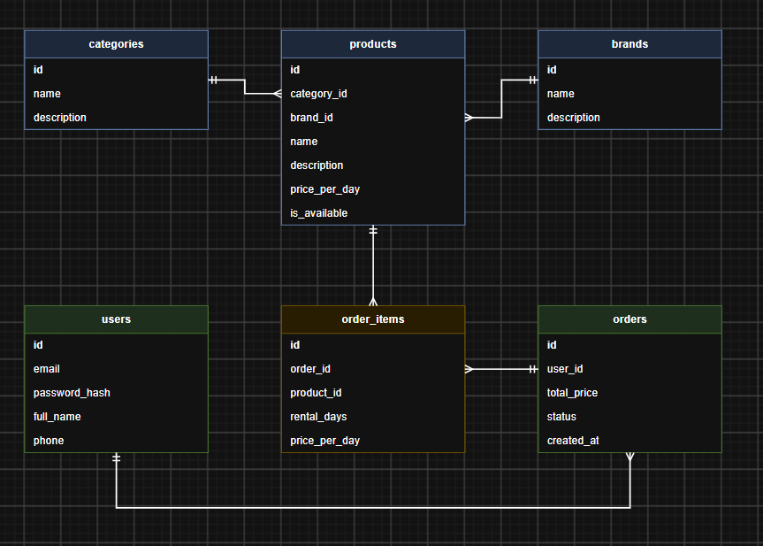

# GearRent
- Це вебплатформа для оренди та прокату спорядження для активного відпочинку, туризму, спорту та фото або відеозйомки.

Застосунок вирішує проблему високої вартості купівлі дорогого обладнання для разових поїздок чи хобі. На сайті користувачі можуть переглядати каталог доступного спорядження, шукати товари за назвою, фільтрувати їх за категоріями, брендами та ціною оренди за добу, а також переглядати детальні характеристики товарів та інформацію про бренд або категорію.

## REST API Endpoints (`/api/v1`)

Усі дані передаються у форматі **JSON**.

### Товари (`/products`)
* `GET /products` — Отримати каталог (query: `search`, `category_id`, `brand_id`, `sort_by`).  
  * **Status:** `200 OK` | **Res:** `[{"id": 1, "name": "Намет", "price_per_day": 250.0, "is_available": true}]`
* `GET /products/{id}` — Деталі товару.  
  * **Status:** `200 OK` | **Res:** `{"id": 1, "name": "Намет", "description": "2-місний", "price_per_day": 250.0}`
* `POST /products` — Додати товар (Admin).  
  * **Req:** `{"name": "Рюкзак", "price_per_day": 180.0, "category_id": 1, "brand_id": 3}`  
  * **Status:** `201 Created` | **Res:** `{"id": 2, "name": "Рюкзак", "price_per_day": 180.0}`
* `PUT /products/{id}` — Оновити товар (Admin).  
  * **Req:** `{"name": "Рюкзак Pro", "price_per_day": 200.0}`  
  * **Status:** `200 OK` | **Res:** `{"id": 2, "name": "Рюкзак Pro", "price_per_day": 200.0}`
* `DELETE /products/{id}` — Видалити товар (Admin).  
  * **Status:** `204 No Content`

### Категорії (`/categories`)
* `GET /categories` — Список категорій.  
  * **Status:** `200 OK` | **Res:** `[{"id": 1, "name": "Намети"}]`
* `GET /categories/{id}/products` — Товари категорії.  
  * **Status:** `200 OK` | **Res:** `[{"id": 1, "name": "Намет", "price_per_day": 250.0}]`
* `POST /categories` — Створити категорію (Admin).  
  * **Req:** `{"name": "Альпінізм"}`  
  * **Status:** `201 Created` | **Res:** `{"id": 2, "name": "Альпінізм"}`


### Авторизація та Користувачі (`/auth`, `/users`)
* `POST /auth/register` — Реєстрація.  
  * **Req:** `{"email": "user@test.com", "password": "123", "full_name": "Іван", "phone": "+380970000000"}`  
  * **Status:** `201 Created` | **Res:** `{"id": 1, "email": "user@test.com"}`
* `POST /auth/login` — Вхід у систему.  
  * **Req:** `{"email": "user@test.com", "password": "123"}`  
  * **Status:** `200 OK` | **Res:** `{"token": "jwt_token", "user": {"id": 1, "email": "user@test.com"}}`
* `GET /users/me` — Профіль користувача.  
  * **Status:** `200 OK` | **Res:** `{"id": 1, "email": "user@test.com", "full_name": "Іван"}`
* `PATCH /users/me` — Оновити профіль.  
  * **Req:** `{"full_name": "Іван Петренко"}`  
  * **Status:** `200 OK` | **Res:** `{"id": 1, "full_name": "Іван Петренко"}`

### Замовлення (`/orders`)
* `POST /orders` — Оформити замовлення.  
  * **Req:** `{"items": [{"product_id": 1, "rental_days": 3}]}`  
  * **Status:** `201 Created` | **Res:** `{"order_id": 101, "status": "created", "total_price": 750.0}`
* `GET /users/me/orders` — Історія замовлень.  
  * **Status:** `200 OK` | **Res:** `[{"order_id": 101, "total_price": 750.0, "items": [{"product_id": 1, "rental_days": 3}]}]`

  

## Як запустити проєкт

Адреси й порти:


1. Запустіть бекенд:

   ```bash
   python manage.py migrate
   python manage.py loaddata demo_data
   python manage.py runserver
   ```
2. Відкрийте в браузері `http://127.0.0.1:8000/api/v1`.

